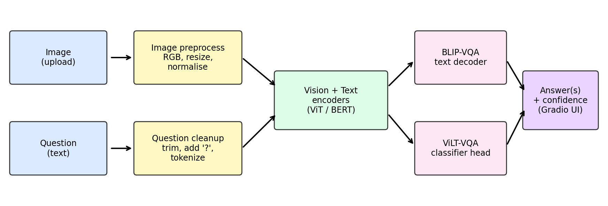

# Visual Question Answering (VQA) using Pretrained Vision-Language Models

Experiential Learning Assignment (individual submission), Task 14: Visual Question Answering.
Given an image and a natural-language question, the system answers using pretrained models
(BLIP-VQA and ViLT-VQA) and lets you compare them.

## Author
| Name | Roll No | Contribution |
|------|---------|--------------|
| Aditya Srivastava | 2330062 | Individual project: design, implementation, evaluation, project report |

## Pipeline


## Models
- BLIP-VQA: https://huggingface.co/Salesforce/blip-vqa-base
- ViLT-VQA: https://huggingface.co/dandelin/vilt-b32-finetuned-vqa
- Reference dataset: VQA v2 (https://visualqa.org), used to describe the models' training; our own test set is in `samples/`.

## Setup and run
```bash
python -m venv venv && source venv/bin/activate     # Windows: venv\Scripts\activate
pip install -r requirements.txt
python src/app.py                                    # opens http://127.0.0.1:7860
python src/evaluate.py samples/questions.csv         # batch evaluation -> outputs/predictions.csv
```
First run downloads about 1.5 GB of model weights. A GPU is optional, CPU works at a few seconds per question.

## Repository layout
```
src/vqa_pipeline.py   model wrappers + preprocessing
src/app.py            Gradio demo
src/evaluate.py       exact-match evaluation
samples/              test images and questions.csv
outputs/              predictions.csv, screenshots
docs/                 pipeline diagram, report PDF, slides
```

## Limitations
Pretrained on everyday photos; weak at counting, reading text in images, and cultural or domain-specific content.
Answers are short and carry no explanation.
